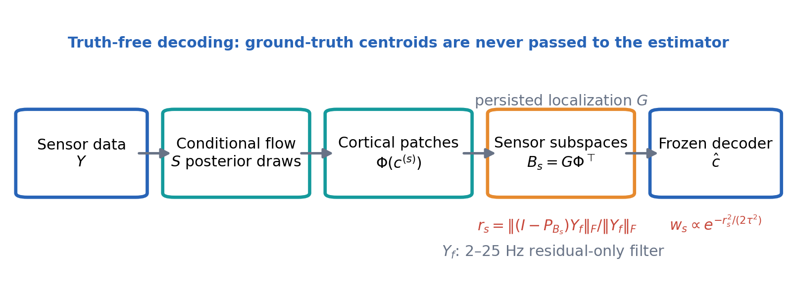
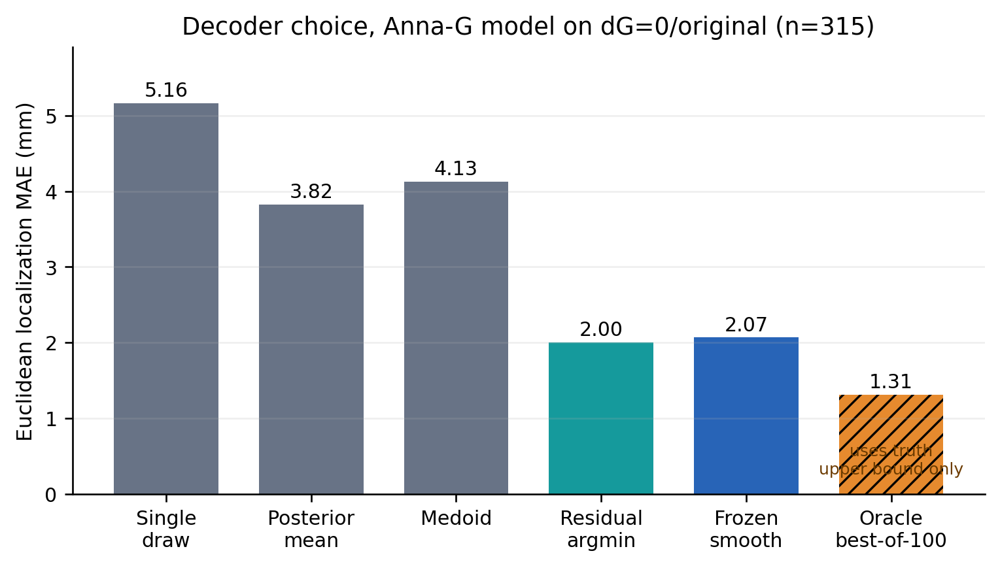
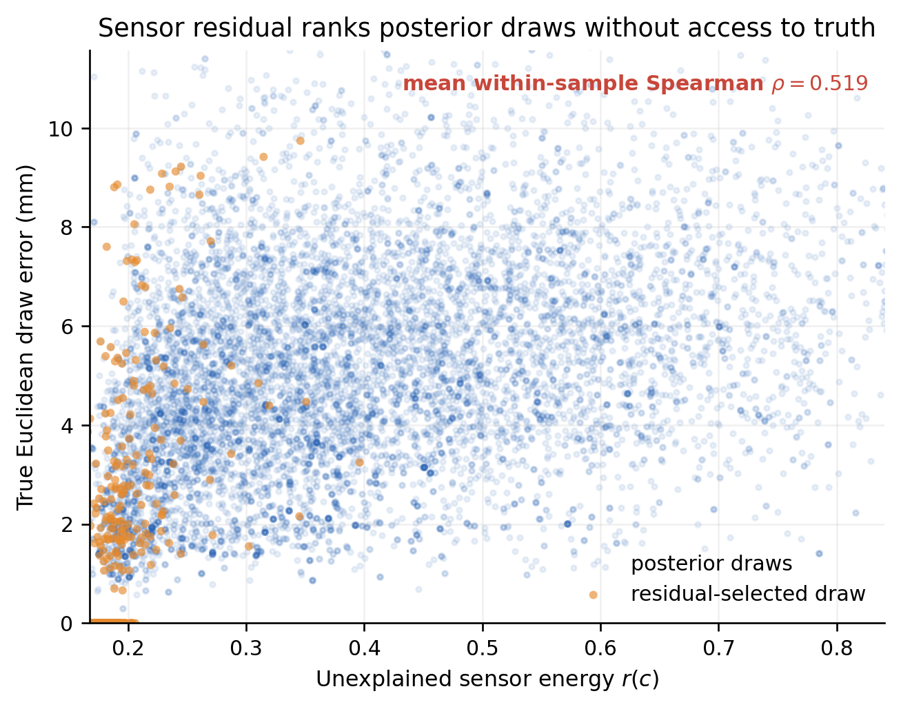
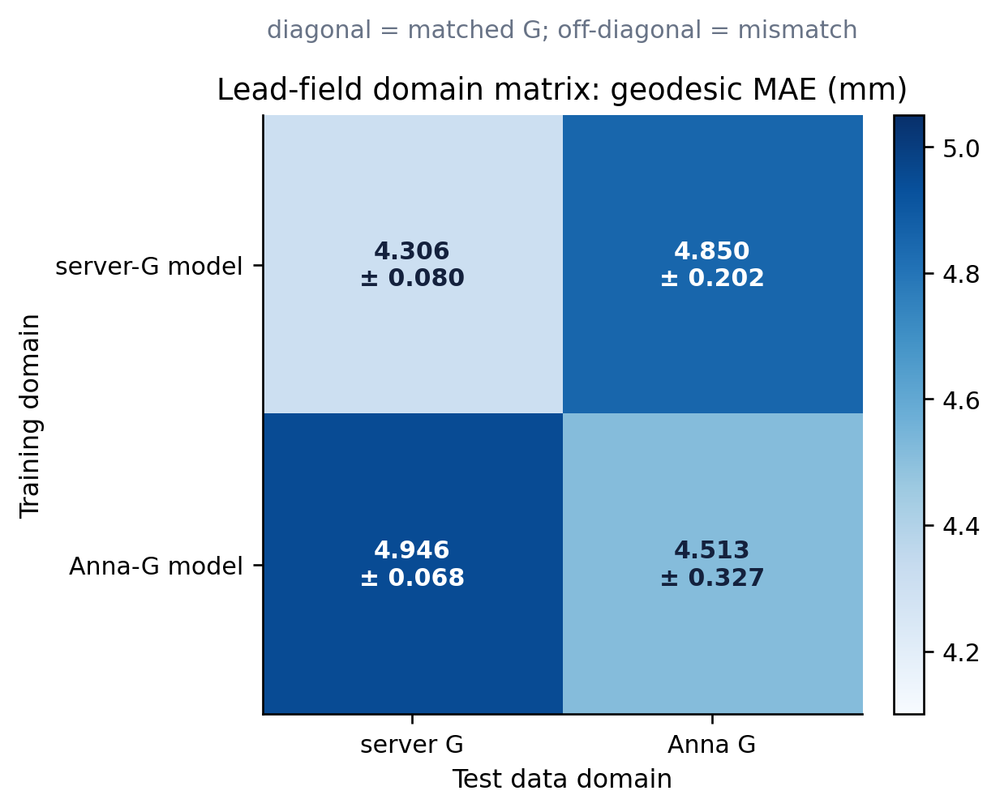
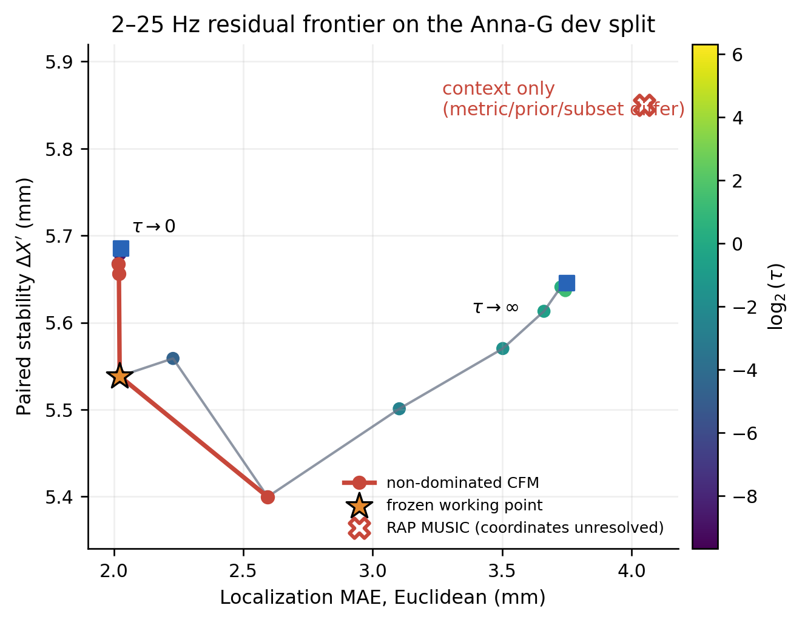
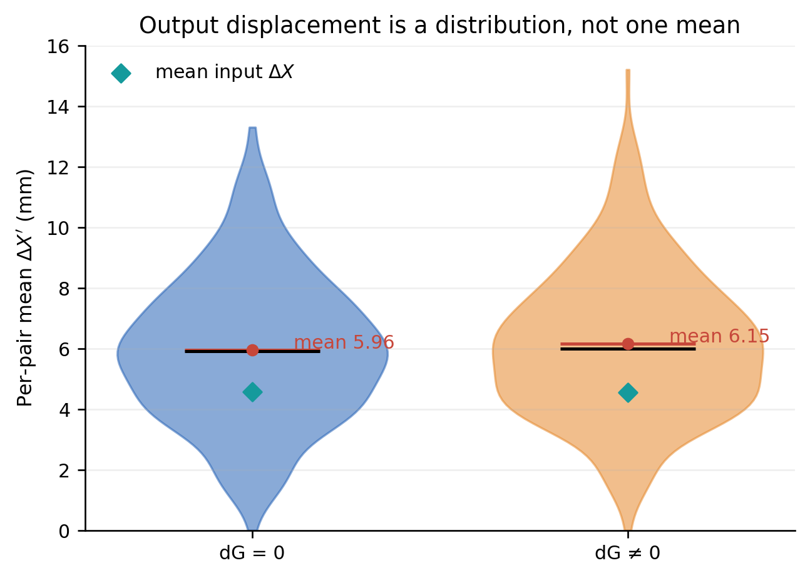

# Canonical results: conditional flow matching for MEG localization

Frozen: 2026-08-11. This is the single source of truth for project results.
The dated reports remain an audit trail and are superseded by this document.

## 1. Problem and notation

The simulator generates MEG sensor data

\[
Y = G\Phi(c)^\top A + \eta,
\]

where `G` is the lead field, `c` contains three cortical source centroids,
`Φ(c)` contains their Gaussian surface patches, and `A` contains unknown time
courses. A conditional flow-matching model draws samples from its learned
posterior over centroid coordinates. The central question is how to turn those
draws into one localization without using the true centroids.

The primary complete accuracy metric is Euclidean source-assignment MAE.
Geodesic MAE is also reported, but means are finite-only because the mesh has
disconnected hemispheres. The primary stability metric is paired Euclidean
`ΔX′`, the displacement between estimates from original and shifted sensor
inputs after each estimate is assigned to its own true source ordering. The
mean physical input displacement is `ΔX = 4.5663 mm` for `dG=0` and `4.5567
mm` for `dG≠0`.

Full definitions and derivations are in `docs/math.md` in the article
repository. Figure 1 summarizes the implemented inference path.

## 2. The decoder, not the trained weights, was the main accuracy defect

Historical evaluation drew `N` posterior samples and kept the one closest to
ground truth. This `oracle_best_of_N` statistic is an upper bound on sample
quality, not a deployable localizer. Removing it initially made performance
look much worse, but five truth-free decoders showed that good solutions were
already present in the posterior.

For candidate centroids `c`, the residual decoder builds

\[
B(c)=G\Phi(c)^\top,
\qquad
r(c)=\frac{\lVert(I-P_B)Y\rVert_F}{\lVert Y\rVert_F}.
\]

The final decoder applies the same zero-phase fourth-order 2–25 Hz Butterworth
filter as the RAP MUSIC pipeline, only before residual evaluation. If `F`
acts on time, `Y_f=YF=B(AF)+ηF`; therefore `col(B)` is unchanged exactly. The
CFM sampler still receives raw `Y`.

It uses only `Y`, the persisted localization `G`, mesh geometry, and the
dataset-level spatial patch parameters. Ground truth is excluded from the
estimator API. On the final Anna-G model and the 315 `dG=0` original inputs:

| decoder | honest? | MAE euc, mm | MAE geo, mm | interpretation |
|---|:---:|---:|---:|---|
| single draw | yes | 5.1645 | 9.7368 | raw posterior sample; filtering-independent control |
| posterior mean | yes | 3.8222 | 7.5168 | averages all modes |
| posterior medoid | yes | 4.1285 | 8.2366 | densest draw mode |
| residual argmin | yes | **2.0026** | **3.5872** | filtered sensor-subspace fit |
| frozen smooth | yes | 2.0674 | 3.6551 | refrozen filtered Gibbs decoder |
| oracle best-of-100 | **no** | 1.3143 | 1.6849 | truth-selected upper bound only |

The residual is scientifically informative, not merely a post-hoc score. Its
mean within-sample Spearman association with true Euclidean draw error is
`0.519` on original and `0.540` on shifted `dG=0` inputs. The association stays
positive after `dG` perturbation (`0.509/0.527`). Filtering changed these
correlations by only `+0.001…+0.002`, so the expected large ranking-contrast
gain was not observed; the practical gain comes mainly from refreezing a
colder working point. The measured data nevertheless rank better and worse
posterior draws without access to truth.

The corrected paired IID-100×3 ranking selected `trial81_honest_4965`: its
geodesic MAE was `4.3057 ± 0.0799 mm`, versus `4.7815 ± 0.2607 mm` for
`push_3771` and `5.2502 ± 0.3628 mm` for the original checkpoint. It won all
three paired seeds. This is coherent with the training procedure: the model
selected honestly by validation became first once evaluation was also honest.

## 3. Forward-model domain shift and controlled retraining

The historical server and Anna lead fields are structurally different:

- raw relative Frobenius difference: `36.8%`;
- after optimal global scaling: `35.55%` (`α = 0.907`);
- median projector-aware principal angle on real centroid triplets: `7.84°`;
- 90th percentile of the maximum triplet angle: `60.44°`.

Truth-centroid residual calibration classified the fixed server test as
rebuilt-like in `298/300` cases and Anna's `dG=0` data as Anna-like in
`313/315`. The training dataset did not persist `G`; its rebuilt-like domain is
supported directly by its sensor data and artifact dates, but the exact
historical matrix is unrecoverable. Every new generated dataset now persists
its `G`.

A controlled retraining changed only the forward model. Mesh, latent source
locations, simulation settings, seeds, hyperparameters, and split policy were
held fixed; no sweep was run. The central paired matrix uses the truth-free
residual argmin with 100 draws:

| training model | server-G test, Geo mm | Anna-G test, Geo mm |
|---|---:|---:|
| server-G `honest_4965` | **4.3057 ± 0.0799** | 4.8497 ± 0.2022 |
| Anna-G `honest_4965_annaG` | 4.9463 ± 0.0681 | **4.5131 ± 0.3273** |

The paired geodesic mismatch cost is `+0.5441 mm` from server to Anna and
`+0.4332 mm` in the reverse direction. Under frozen smoothing the corresponding
range is `+0.4037` to `+1.1603 mm`; this wider, directional result is a real
decoder×domain interaction, not solely the use of different temperatures.
The closeout domain-cost interval is therefore **+0.404 to +1.160 mm Geo**
across decoder and direction (Euclidean: `+0.022` to `+0.550 mm`).

The experiment closes the retraining question: retraining is useful for
matching a changed physical operator, but the earlier error was not evidence
that the original weights had failed in their own domain.

## 4. Accuracy and stability next to RAP MUSIC

The final Anna-G model uses a quadratic Gibbs decoder whose temperature was
frozen on an independent 350-pair development split by the preregistered rule
“minimize `ΔX′` subject to `MAE_euc ≤ 1.10 × MAE_euc(argmin)`.” The selected
temperature after 2–25 Hz residual filtering was `τ = 0.0195161`; the old
unfiltered value `0.0383041` was not reused. No Anna collaboration pair was
used for either choice.

| method / scenario | accuracy on original inputs | `ΔX′` all pairs | `ΔX′` after method's own cross-component exclusions |
|---|---:|---:|---:|
| CFM Anna-G filtered, `dG=0` | **2.0674 Euc / 3.6551 Geo** | 5.9583 (`n=315`) | **5.9144** (`n=305`) |
| RAP MUSIC, reported `dG=0` | 4.05 Geo | not reported | 5.85 (own valid subset) |
| CFM Anna-G filtered, `dG≠0` | **2.1991 Euc / 4.0218 Geo** | 6.1534 (`n=315`) | **6.1489** (`n=301`) |
| RAP MUSIC, reported `dG≠0` | 4.78 Geo | not reported | 6.13 (own valid subset) |

Anna confirmed that `4.05/4.78` and `5.85/6.13` were computed on the same
collaboration simulations and that the geodesic accuracy uses the real mesh
graph. Her code also shows that RAP MUSIC excludes pairs with its own
interhemispheric failures, while the complete CFM metric includes all 315. The
last column is the symmetric comparison: each method excludes its own failures.
The resulting stability values remain numerically aligned. A common-intersection
mask is unavailable and is not inferred.

Absolute accuracy still is not an algorithm-only comparison. The CFM residual
uses the true Gaussian patch family and radii `R=(10,8,10) mm`, while RAP MUSIC
fits point dipoles; CFM/simulation use fixed cortical-normal orientation while
RAP MUSIC uses free orientation; RAP estimates noise from the known empty
1.7–1.8 s window. We therefore do not claim statistical superiority.

## 5. Accuracy–stability frontier

The filtered development curve spans the measured limits `τ→0` (residual
argmin) and large `τ` (posterior mean). Its non-dominated points are:

| decoder point | `τ` | MAE euc, mm | `ΔX′` euc, mm |
|---|---:|---:|---:|
| quadratic `2^-6` | 0.0048790 | **2.0157** | 5.6675 |
| quadratic `2^-5` | 0.0097580 | 2.0190 | 5.6559 |
| **frozen working point, `2^-4`** | **0.0195161** | 2.0221 | 5.5383 |
| quadratic `2^-2` | 0.0780642 | 2.5938 | **5.3997** |
| argmin limit | 0 | 2.0260 | 5.6854 |
| large-`τ` limit | 79.94 | 3.7490 | 5.6459 |

The preregistered rule selected `τ=0.0195161` with dev `MAE_euc=2.0221 mm` and
`ΔX′=5.5383 mm`; filtered hard-argmin MAE was `2.0260 mm`. Filtering moves the
frozen point but does not create a new estimator family.

The reported RAP point `(4.05, 5.85)` uses geodesic accuracy, whereas the CFM
frontier uses Euclidean accuracy. It is therefore shown for numerical context,
not assigned a formal Pareto status. No new estimator is needed: the achievable
CFM set is measured.

## 6. Stability under `dG` and Monte Carlo sampling

For the final Anna-G model, the smooth paired output distributions are:

| scenario | mean `ΔX`, mm | mean `ΔX′`, mm | median | p90 | maximum |
|---|---:|---:|---:|---:|---:|
| `dG=0` | 4.5663 | **5.9583** | 5.9222 | 9.0650 | 13.3051 |
| `dG≠0` | 4.5567 | **6.1534** | 6.0029 | 9.2958 | 15.2087 |

Across filtered decoder and input branch, `dG` changes geodesic localization
MAE by `+0.205` to `+0.367 mm`. Averaging original and shifted branches gives
`+0.265 mm` for hard argmin and `+0.286 mm` for frozen smoothing. Against the
reported RAP MUSIC change `+0.73 mm`, normalized sensitivity is approximately
`2.55×` lower for the frozen CFM point, consistent with the earlier order-2.4
result. Paired Euclidean `ΔX′` cost is `+0.060 mm` for argmin and `+0.195 mm`
for frozen smoothing. These remain smaller than the natural server-G/Anna-G
mismatch cost.

The Monte Carlo control is a discrete-tail phenomenon: median jitter is zero
at 100, 300, and 1000 draws, while occasional estimates jump by millimetres.
On the first 30 exact pairs, the nonzero-jump fraction fell from `43.3%` to
`16.7%` on `dG=0` and from `33.3%` to `20.0%` on `dG≠0` as draws increased
from 100 to 1000. At 100 draws, restricting to zero-jitter samples reduced
`ΔX′` from `6.70` to `6.43 mm` (`dG=0`) and from `6.64` to `5.83 mm`
(`dG≠0`). Finite sampling inflates a tail, but it does not explain away the
response to the input shift. This `n=30` subset is diagnostic and does not
replace the `n=315` primary estimates.

The patch-radius disclosure is experimentally material. On filtered `dG=0`
original inputs, hard residual selection gives `2.003/3.587 mm` Euc/Geo with
the true radii. Using `0.7R` degrades this to `2.928/5.122 mm`; using `1.3R`
gives `2.638/4.722 mm`. The decoder's knowledge of the source family therefore
accounts for a substantial part of its absolute accuracy.

## 7. Limitations, closed questions, and open collaboration checks

### Closed without further work

- **Oracle contamination:** twelve independent truth-selected evaluator
  locations are catalogued. Key historical values are retained and explicitly
  renamed `oracle_best_of_N_*`; same-corpus honest replacements are used where
  available.
- **Permutation swapping between draws:** non-identity rate `0.014%`; rejected
  as the reason posterior averaging failed. The small rate is explained by the
  fixed temporal windows and frequency bands that distinguish the three source
  slots. It need not generalize when those signatures are randomized.
- **`min_perm_loss`:** no invalid minimum arithmetic. The implementation chooses
  one permutation after batch averaging, so it is batch-global rather than a
  per-sample set loss. No repair or retraining is part of closeout.
- **Original/shifted difficulty asymmetry:** source spacing, lead-field norm and
  normal-angle observability, and the neighbor-correction branch were tested
  and rejected as primary explanations. The fixed head-coordinate shift
  remains a documented protocol limitation that can affect both methods. No
  fourth hypothesis is pursued.
- **Retraining, new decoders, and sweeps:** stopped. The controlled retraining
  and measured frontier answer the questions they were meant to answer.

### Accepted comparison boundary

Anna confirmed that both methods' reported values use the same collaboration
simulations and that RAP MUSIC's geodesic accuracy is evaluated on the real
mesh graph. Code review resolved source matching and showed the asymmetric
failure subsets, point-patch versus Gaussian-patch model, free versus fixed
orientation, fixed temporal signatures, and empty-window noise estimate. These
are now explicit comparison boundaries; no further external clarification is
required for this recomputation.

## Provenance index

- Phase-1 closeout: `reports/closeout/phase1-summary.md`
- Oracle, `dG`, and `min_perm_loss` audit: `reports/closeout/phase2-debt-audit.md`
- Disk review, no deletions: `reports/closeout/disk-cleanup-candidates.md`
- Controlled Anna-G experiment: `reports/2026-08-11-anna-g-retrain-scientific-report.md`
- Filtered residual recomputation: `reports/2026-08-15-filtered-residual-recompute-report.md`
- Figure generator: `closeout_figures.py`
- Figure manifest with SHA-256 hashes: `paper/imgs/manifest.json`

The public-facing manuscript should cite this file, not extract headline
numbers directly from the dated audit reports.
