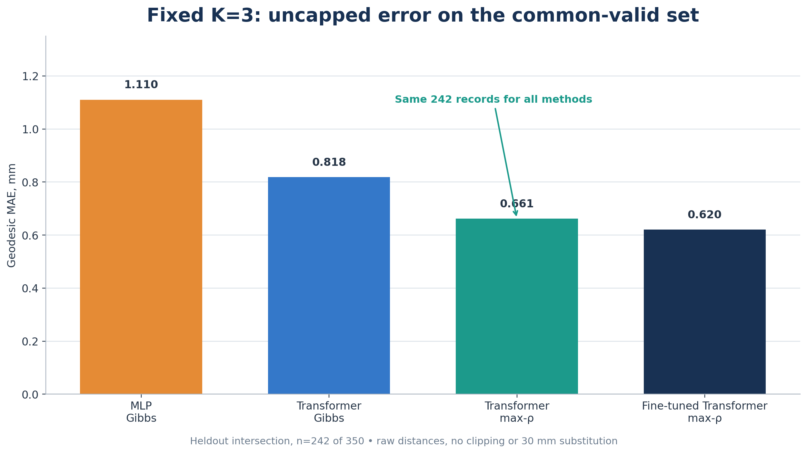

# Fixed `K=3`: common-valid сравнение без штрафа 30 мм



## Что именно сравниваем

Цель этого среза — измерить точность локализации на одних и тех же записях,
где методы не попали в штрафной режим `MAE_GEO@30`.

Запись считается **хорошей** для метода, если все три сохранённых расстояния
`refined_assigned_geodesic_mm`:

- существуют и являются конечными;
- соответствуют трём сопоставленным парам источников;
- строго меньше `30.0 mm`.

Общий набор содержит только записи, хорошие одновременно для всех методов в
конкретном сравнении. После отбора считается обычная метрика без обрезания:

```text
MAE_GEO = mean over records(mean over 3 matched raw geodesic distances)
```

Число `30 mm` участвует только в определении набора. В итоговый `MAE_GEO` оно
не подставляется, расстояния не обрезаются.

## Основное сравнение архитектур

Здесь обе модели используют один и тот же декодер `Gibbs-weighted medoid`,
банк `S=800` и одинаковый heldout-набор. Поэтому различие лучше всего отражает
замену MLP на Transformer.

Общий хороший набор: **244 из 350 записей (69.7143%)**. Исключено **106
записей (30.2857%)**.

| Метод | Обычный MAE_GEO, mm | Медиана record MAE, mm | P90, mm | Максимум, mm |
|---|---:|---:|---:|---:|
| MLP + Gibbs-weighted medoid | 1.163681 | 0.000000 | 4.689223 | 15.509559 |
| Transformer + Gibbs-weighted medoid | **0.811638** | 0.000000 | **3.748452** | 16.085293 |

На этом фиксированном наборе Transformer уменьшает средний `MAE_GEO` на
**0.352043 mm**, или **30.2526%** относительно MLP.

Парный bootstrap для разности `Transformer − MLP` даёт 95% интервал
`[-0.706925; -0.003736] mm` (200 000 повторов, seed `20261005`). Двусторонний
критерий Уилкоксона даёт приближённое `p = 0.026940`. На уровне отдельных
записей Transformer лучше в 28 случаях, MLP лучше в 18, ещё 198 результатов
совпадают точно, в основном из-за нулевой ошибки.

## Сравнение всех четырёх fixed-K пайплайнов

Чтобы сравнить также правило выбора кандидата и fine-tuning, построен более
строгий набор: запись должна быть хорошей одновременно для всех четырёх
вариантов. Осталось **242 из 350 записей (69.1429%)**; исключено **108
(30.8571%)**.

| Метод | Обычный MAE_GEO, mm | Медиана record MAE, mm | P90, mm | Максимум, mm |
|---|---:|---:|---:|---:|
| MLP + Gibbs-weighted medoid | 1.110264 | 0.000000 | 4.481531 | 15.509559 |
| Transformer + Gibbs-weighted medoid | 0.818345 | 0.000000 | 3.842804 | 16.085293 |
| Transformer + max-rho | 0.661472 | 0.000000 | 2.693498 | **9.320009** |
| Fine-tuned Transformer + max-rho | **0.620430** | 0.000000 | **2.276130** | **9.320009** |

Это сравнение оценивает целые пайплайны. Разницу между строками нельзя
приписать только архитектуре, потому что одновременно меняются правило выбора
кандидата и наличие fine-tuning.

## Coverage: сколько записей проходит фильтр у каждого метода

Эти значения не входят в обычный `MAE_GEO`, но нужны рядом с ним, чтобы низкая
ошибка на хорошем подмножестве не скрывала неудачные случаи.

| Метод | Хорошие записи | Coverage | Записи со штрафным случаем |
|---|---:|---:|---:|
| MLP + Gibbs-weighted medoid | 282 / 350 | 80.5714% | 68 |
| Transformer + Gibbs-weighted medoid | 279 / 350 | 79.7143% | 71 |
| Transformer + max-rho | 324 / 350 | 92.5714% | 26 |
| Fine-tuned Transformer + max-rho | 328 / 350 | **93.7143%** | **22** |

## Как интерпретировать результат

Для ответа на вопрос «какая архитектура точнее на решаемых случаях?» основной
результат — `1.163681 mm` для MLP против `0.811638 mm` для Transformer на одном
и том же наборе из 244 записей. В этом сравнении Transformer лучше.

Фильтрация зависит от результатов моделей, поэтому это условная метрика, а не
оценка всего heldout-набора. Её разумно публиковать вместе с coverage. Тогда
точность и надёжность представлены раздельно:

1. **Common-valid MAE_GEO** — насколько точно метод локализует источники на
   общем наборе без штрафных случаев.
2. **Coverage / failure rate** — как часто метод вообще попадает в этот режим.

Такой формат не использует искусственную подстановку `30 mm` и при этом не
скрывает исключённые записи.

## Воспроизведение

Запуск:

```bash
python experiments/compare_fixed_k_common_valid.py
```

Скрипт создаёт:

- `reports/transformer-common-valid/fixed_k_common_valid_summary.json` — результаты с полной точностью;
- `reports/transformer-common-valid/fixed_k_common_valid_summary.csv` — плоская итоговая таблица;
- `reports/transformer-common-valid/fixed_k_common_valid_architecture_records.csv` — 244 записи
  основного сравнения с исходными расстояниями;
- `reports/transformer-common-valid/fixed_k_common_valid_all_four_records.csv` — 242 записи сравнения
  всех пайплайнов с исходными расстояниями.
